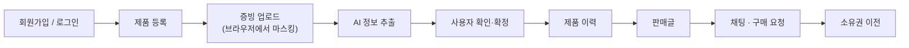

# Pastport

<!--
README 작성 전 채워야 할 항목 (완료하면 이 블록과 아래 TODO 주석을 지운다)

[필수]
1. 요구사항 정의서 링크            → "문서" 표
2. ERD 링크                        → "문서" 표
3. API 명세 링크 (Swagger 대체 여부 결정) → "문서" 표
4. 팀원 이름·GitHub 계정·담당 영역   → "팀원" 섹션

[확인]
5. 서비스 한 줄 소개 문구 확정      → 제목 바로 아래
6. 협업 규칙의 브랜치·커밋·PR 이름 형식 → "협업 규칙"
7. .env.example의 변수와 환경 변수 표가 일치하는지 → "로컬 실행"

[선택]
8. 로고 이미지
9. 주요 화면 스크린샷 또는 시연 링크
-->

> 노트북의 구매·수리 이력을 증빙과 함께 쌓아, 믿을 수 있는 중고거래로 이어 주는 서비스

<!-- TODO(5): 팀에서 쓰는 공식 소개 문구로 교체 -->
<!-- TODO(8): 로고 이미지를 넣을 경우 제목 위에 <p align="center"></p> 추가 -->

 전자제품 관리와 중고거래를 하나로 잇고, 초기 MVP는 **노트북**을 대상으로 한다.

중고 노트북은 "정말 관리가 잘 된 제품인지" 알기 어렵다. Pastport는 영수증·보증서·수리 명세서 같은 **증빙을 올리고, AI가 제품 정보를 읽어 주고, 사용자가 확인해서 이력으로 남기는 흐름**을 만든다. 그렇게 쌓인 이력이 판매글의 근거가 된다.



<!-- TODO(9): 주요 화면 스크린샷 또는 시연 링크 추가 (마스킹 화면, 증빙 목록, 판매글 등) -->

## 핵심 포인트

- **개인정보를 서버에 남기지 않는 증빙 처리:** 원본은 브라우저에서만 다루고, 사용자가 가린 사본만 서버로 올린다.
- **AI는 초안만 만들고 확정은 사람이 한다:** AI가 뽑은 값은 후보일 뿐이며, 사용자가 검토·수정한 값만 이력에 반영한다.
- **오래된 결과가 최신을 덮어쓰지 못하게 하는 버전 관리:** 문서·제품·판매글에 버전 번호를 두고 확인한 버전이 다르면 거부한다.
- **소유자는 제품 한 곳만 기준:** 제품이 양도돼도 같은 제품 번호에 사진·증빙·이력이 이어진다.
- **스키마는 Flyway로만 변경:** 상태 규칙은 코드와 DB 제약 양쪽에서 막는다.

## 팀원

<!-- TODO(4): 팀원 이름, GitHub 계정, 담당 영역을 채운다.
     커밋 기록에서 확인된 GitHub 계정: pjmoo, a1l1ke, JtaeHyeon, yeunyeuna, goarns77, wuuk
     (이 목록에 없는 팀원이 있으면 직접 추가) -->

| 이름 | GitHub | 담당 |
| --- | --- | --- |
| TODO | TODO | TODO |

## 기술 스택

| 구분 | 내용 |
| --- | --- |
| Backend | Java 17, Spring Boot 4.1.1, Spring Web MVC, Spring Data JPA, Bean Validation, Gradle 9.7.1 |
| 인증 | Spring Security, OAuth2 Resource Server (HS256 JWT) |
| DB | PostgreSQL 17, Flyway(스키마 마이그레이션) |
| 캐시·토큰 | Redis 8 |
| API 문서 | springdoc OpenAPI (Swagger UI) |
| Frontend | HTML + JavaScript (`src/main/resources/static`) |
| 테스트·품질 | JUnit 5, Mockito, Spotless(google-java-format) |
| 실행 환경 | Docker Compose (PostgreSQL · Redis) |

기술 기준과 사용하지 않는 기술(pgvector, RAG, Kafka 등)은 [초기 세팅 가이드](INITIAL_SETUP.md)를 본다.

## 아키텍처

```text
Controller → Service → Repository → Entity
```

- Controller에는 비즈니스 로직을 두지 않고, Repository를 직접 호출하지 않는다.
- API 요청·응답은 DTO를 쓰며 Entity를 그대로 반환하지 않는다.
- 도메인별 패키지(`auth`, `product`, `document`, `history`, `listing`, `chat`, `trade`, `ownership`, `ai`)와 공통 코드(`common`)로 나눈다.

## 로컬 실행

### 1. 준비

- JDK 17
- Docker Desktop 또는 Docker Engine + Docker Compose

### 2. 환경 변수

```bash
cp .env.example .env
```

`.env`는 Git에서 제외된다. 비밀번호·JWT 키·API 키는 저장소에 커밋하지 않는다.

<!-- TODO(7): 아래 표의 변수명과 기본값을 .env.example 및 INITIAL_SETUP.md와 대조해 확인 -->

| 변수 | 용도 |
| --- | --- |
| `POSTGRES_PASSWORD` | Docker PostgreSQL 비밀번호 |
| `DB_PASSWORD` | 애플리케이션 DB 비밀번호 (로컬에서는 `POSTGRES_PASSWORD`와 같은 값) |
| `JWT_SECRET` | HS256 JWT 검증 키 (32바이트 이상) |
| `REDIS_HOST` · `REDIS_PORT` | Redis 접속 정보 (기본값 제공) |
| `CORS_ALLOWED_ORIGINS` | 허용할 프런트엔드 Origin |
| `LOCAL_STORAGE_ROOT` | 로컬 파일 저장 경로 (기본 `./storage`) |

> Docker Compose는 `.env`를 자동으로 읽지만, Spring Boot와 IntelliJ 실행 구성은 읽지 않는다. 실행 구성의 환경 변수에 `DB_PASSWORD`, `JWT_SECRET`을 직접 등록한다.

### 3. DB와 Redis 실행

```bash
docker compose up -d
docker compose ps
```

처음 실행하면 애플리케이션 DB `aibe7`과 테스트 DB `aibe7_test`가 함께 만들어진다. 로컬 데이터를 모두 지우고 다시 시작하려면 `docker compose down -v`를 쓴다(볼륨 삭제).

### 4. 애플리케이션 실행

IntelliJ에서 `SpringTestCiApplication`을 실행한다. 기본 프로필은 `local`이다.

실행 후 API 문서는 다음 주소에서 확인한다.

```text
http://localhost:8080/swagger-ui.html
```

### 5. 테스트

```bash
./gradlew spotlessCheck
./gradlew test
./gradlew build
```

## 폴더 구조

| 경로 | 내용 |
| --- | --- |
| `src/main/java/org/example/springtestci/` | 백엔드 소스 (도메인별 패키지 + `common`) |
| `src/main/resources/db/migration/` | Flyway 마이그레이션 |
| `src/main/resources/static/` | 화면 (HTML·CSS·JS) |
| `docs/` | 기능별 설계·구현 문서 |
| `scripts/` | 데모·점검 스크립트 |
| `compose.yaml` | 로컬 PostgreSQL · Redis |

## 문서

| 문서                                                        | 내용 |
|-----------------------------------------------------------| --- |
| [환경 세팅 가이드](INITIAL_SETUP.md)                             | 개발 환경, 공통 코드, 패키지 구조, 실행 방법 |
| [개발규칙](AGENTS.md)                                         | 프로젝트 공통 개발 규칙 | 
| TODO(1) 요구사항 정의서 | 기능 요구사항 (링크 또는 `docs/` 파일 경로 필요) |
| TODO(2) ERD | 테이블·제약·관계 (링크 또는 `docs/` 파일 경로 필요) |
| TODO(3) API 명세 | 경로·요청·응답·오류 코드 (Swagger로 대체하면 이 줄 삭제) |

## 협업 규칙

<!-- TODO(6): 팀에서 정한 브랜치·커밋·PR 이름 형식이 있으면 아래에 표로 추가
     예) | 항목 | 형식 | 예 |  / 브랜치, 커밋, PR 제목
     저장소에서 확인되는 규칙이 없어 일부러 비워 두었다. -->

- 기능은 포크에서 브랜치를 만들어 작업하고, 원본 `main`으로 **Pull Request**를 보낸다. `main`에 직접 푸시하지 않는다.
- DB 스키마 변경은 반드시 **Flyway 마이그레이션**으로 하고, 기존 마이그레이션 파일은 수정하지 않는다. `ddl-auto=update`에 의존하지 않는다.
- 새 기능과 주요 비즈니스 로직에는 테스트를 작성한다.
- PR 전에 `spotlessCheck`, `test`, `build`를 통과시킨다.
- 인증·인가와 다른 사용자의 데이터 접근 여부를 확인하고, 비밀번호·토큰·API 키를 코드나 로그에 남기지 않는다.
- 공통 설정(`SecurityConfig`, `application.yaml`, 공용 저장소 등)을 바꾸는 PR은 추가 리뷰를 받는다.
